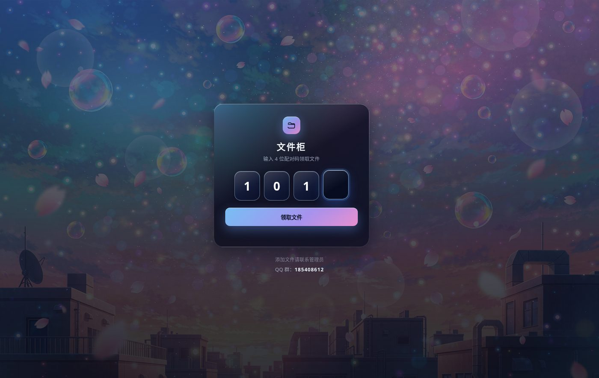
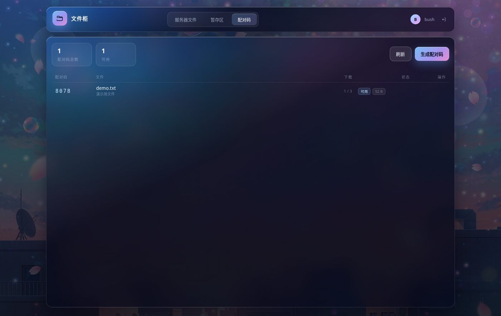

# 文件柜 · File Cabinet

一个自用的私有文件柜：**管理后台需要登录**，**访客只需输入 4 位配对码即可取文件**，不需要注册、不需要登录。

界面是液态玻璃风格，纯手写 CSS，无前端框架。





---

## 功能

**访客侧（无需登录）**

- 打开首页只有一个 4 位配对码输入框，四格玻璃输入，输满自动查询
- 命中后显示文件名、大小、剩余下载次数、备注，一键下载
- 支持过期时间、下载次数上限，失效/停用后立即不可用

**管理侧（登录后）**

- **服务器文件**：从 `/` 浏览整台机器，上传/下载、在线编辑文本、新建文件夹、重命名、删除、显示隐藏文件、按名称过滤
- **暂存区**：拖拽上传（单文件最大 4GB），列表显示大小与占用，可下载/删除，也可把服务器上的文件一键复制进来
- **配对码**：为暂存区的某个文件生成 4 位码，支持自定义码、有效期（小时）、下载次数上限、备注；可停用/启用/删除，点击码即可复制

## 快速开始

依赖 Python 3.9+。

```bash
git clone https://github.com/<you>/file-cabinet.git
cd file-cabinet

python3 -m venv .venv
source .venv/bin/activate
pip install -r requirements.txt

# 生成管理员账号（PBKDF2 哈希，不存明文）
python tools/gen_config.py

# 开发模式启动
python app.py          # http://127.0.0.1:8090
```

生产环境用 gunicorn：

```bash
pip install gunicorn
gunicorn -w 2 -k gthread --threads 8 -b 127.0.0.1:8090 --timeout 900 app:app
```

首次启动会自动创建：

| 文件 | 说明 |
|---|---|
| `config.json` | 账号与站点信息，脚本生成，权限 600 |
| `secret.key` | 会话与下载令牌签名密钥，自动生成 |
| `codes.db` | 配对码 SQLite 数据库，自动创建 |

## 环境变量

| 变量 | 默认值 | 说明 |
|---|---|---|
| `FILE_CAB_STAGING` | `/data/staging` | 暂存区目录，会自动创建 |
| `FILE_CAB_GROUP` | 空 | 访客页底部展示的联系群号，留空则不显示 |

也可以写进 `config.json`：

```json
{
  "users": { "admin": { "salt": "...", "iterations": 240000, "hash": "..." } },
  "site": { "group": "123456789" }
}
```

## 部署

`deploy/` 下有 systemd 与 nginx 示例：

```bash
sudo mkdir -p /opt/filecab && sudo cp -r . /opt/filecab
cd /opt/filecab && python3 -m venv .venv && .venv/bin/pip install -r requirements.txt
sudo cp deploy/filecab.service /etc/systemd/system/
sudo systemctl daemon-reload && sudo systemctl enable --now filecab
```

nginx 反代示例见 `deploy/nginx.conf.example`，两个关键点：

- `client_max_body_size 4096m`（否则大文件 413）
- `proxy_request_buffering off`（大文件直传，不在 nginx 落盘）

HTTPS 建议用 certbot 签，签完把证书路径填进 vhost 即可。

## 目录结构

```
app.py                  # 全部后端逻辑（Flask）
templates/
  public.html           # 访客取件页
  login.html            # 管理员登录
  index.html            # 管理后台
static/
  style.css             # 全部样式（液态玻璃）
  app.js                # 后台交互
  public.js             # 访客页交互
  bg.jpg                # 背景图（AI 生成，可替换）
tools/gen_config.py     # 生成账号配置
deploy/                 # systemd / nginx 示例
```

## 接口

| 方法 | 路径 | 权限 | 说明 |
|---|---|---|---|
| GET | `/` | 公开 | 访客取件页 |
| POST | `/api/public/lookup` | 公开 | 用配对码换下载令牌 |
| GET | `/api/public/download?t=` | 公开 | 凭签名令牌下载 |
| GET/POST | `/login` | 公开 | 管理员登录 |
| GET | `/admin` | 登录 | 管理后台 |
| — | `/api/fs/*` | 登录 | 服务器文件管理 |
| — | `/api/staging/*` | 登录 | 暂存区 |
| — | `/api/codes/*` | 登录 | 配对码管理 |

## 安全设计

- 密码用 **PBKDF2-HMAC-SHA256 / 24 万次迭代 + 随机盐**，配置文件不含明文
- 登录失败同 IP 6 次锁 5 分钟；访客查码限流：每分钟 12 次、每小时 40 次（4 位码只有 1 万种组合，必须限流）
- 访客下载走 **15 分钟有效的签名令牌**，URL 里不暴露服务器真实路径
- 所有写操作校验 **CSRF Token**；会话 Cookie 为 HttpOnly + SameSite=Lax + Secure
- 路径做归一化，暂存区限制在根目录内
- 删除目录需二次确认

## 注意

- 管理后台的文件管理是 **服务进程权限**（通常是 root），能操作整台机器，请只在自己可信的环境暴露后台
- 暂存区文件不会自动清理，长期使用建议加定时任务
- 背景图是 AI 生成的占位素材，可以直接替换 `static/bg.jpg`
